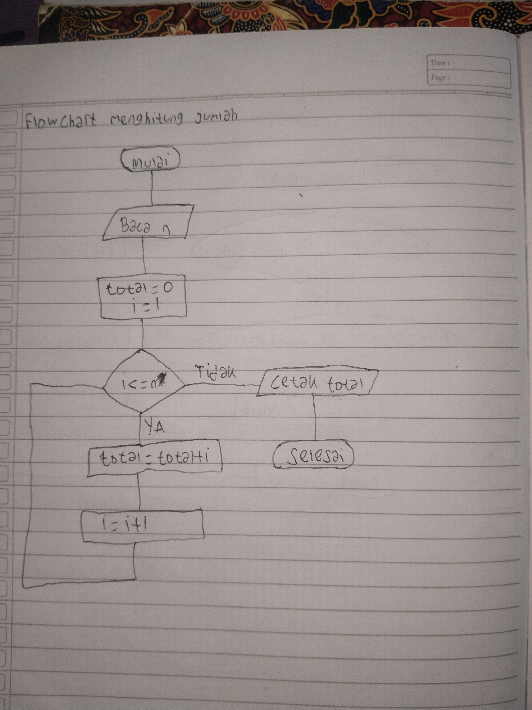
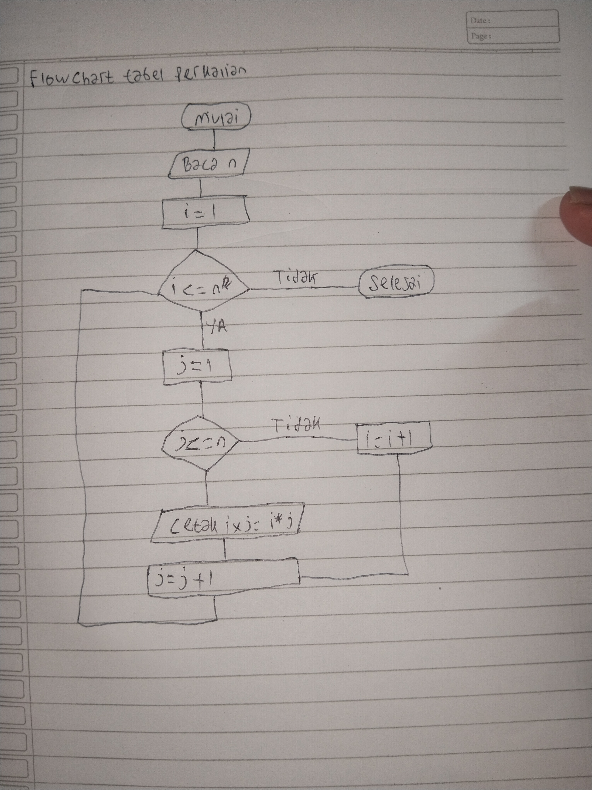

# Pertemuan 5 - Perulangan (C++)

- **Nama:** Muhammad Azmi Azkia
- **NPM:** 2510010458
- **Program Studi:** Teknik Informatika
- **Mata Kuliah:** Pemrograman Terstruktur
- **Pertemuan:** 5

## Daftar Latihan

1. Menghitung jumlah bilangan dari 1 sampai `n`.
2. Mencetak hitung mundur dari `n` sampai 1, lalu menampilkan `Mulai!`.
3. Membaca nilai sampai sentinel negatif dan mencari nilai tertinggi.
4. Menghitung jumlah pilihan menu yang tidak dikenal.
5. Membuat tabel perkalian 1 sampai `n` menggunakan perulangan bersarang.

## 1. Jumlah Bilangan 1 sampai n

File: `membaca_n.cpp`

Program membaca `n`, kemudian menjumlahkan bilangan dari 1 sampai `n` menggunakan `for`. Variabel `total` berfungsi sebagai akumulator.

**Flowchart :**


## 2. Hitung Mundur

File: `hitung_mundur.cpp`

Program mencetak angka dari `n` sampai 1, kemudian mencetak `Mulai!`.

Bagian kepala `for` yang digunakan dan berubah:

```cpp
for (int i = n; i >= 1; i--)
```

Perulangan dimulai dari `n`, berjalan selama `i >= 1`, dan mengurangi `i` satu setiap putaran.

Contoh input `5`:

```text
5
4
3
2
1
Mulai!
```

## 3. Mencari Nilai Tertinggi

File: `nilai_tertinggi.cpp`

Program membaca nilai satu per satu. Masukkan angka negatif untuk menghentikan input. Program menampilkan nilai tertinggi dari nilai yang dimasukkan.

Konsep yang digunakan:
- `while` untuk mengulang selama nilai tidak negatif.
- Sentinel negatif sebagai penanda berhenti.
- `banyak` untuk menghitung jumlah nilai yang dimasukkan.
- `if` untuk membandingkan nilai dan menentukan nilai tertinggi.
- Pemeriksaan `banyak > 0` agar program tidak menampilkan nilai tertinggi jika tidak ada data.

## 4. Menghitung Pilihan Menu yang Tidak Dikenal

File: `pilihantidak_dikenal.cpp`

Program menampilkan menu berulang sampai pengguna memilih `3` untuk keluar. Pilihan selain `1`, `2`, dan `3` dihitung sebagai pilihan yang tidak dikenal.

Variabel `jumlah_salah` bertambah satu di bagian `default` pada `switch`. Jumlah pilihan yang tidak dikenal ditampilkan setelah program selesai.

## 5. Perkalian

File: `perkalian.cpp`

Program mencetak tabel perkalian dari 1 sampai `n` menggunakan dua perulangan `for`:
- Perulangan luar (`i`) menentukan baris.
- Perulangan dalam (`j`) menentukan angka yang dikalikan.
- `i * j` menghasilkan nilai perkalian.
- Baris baru dicetak setelah perulangan dalam selesai.

**Flowchart :**


Contoh input `3`:

```text
1 x 1 = 1    1 x 2 = 2    1 x 3 = 3
2 x 1 = 2    2 x 2 = 4    2 x 3 = 6
3 x 1 = 3    3 x 2 = 6    3 x 3 = 9
```

